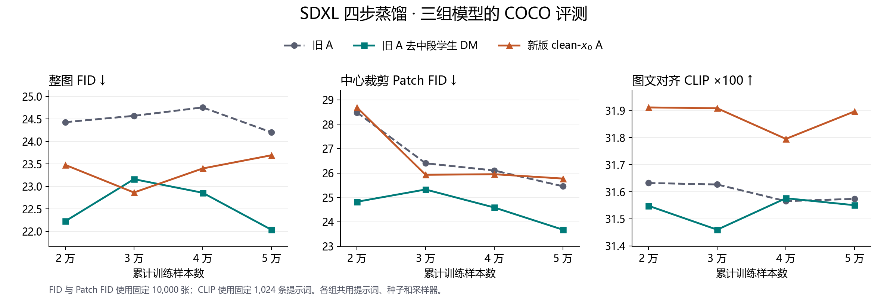

# SDXL 少步蒸馏实验结果

本次整理截至 2026-11-28 的项目归档。训练使用 LAION 衍生子集。FID 与 Patch FID 用固定 COCO2014 的 10,000 项评测，Patch 取中心 299×299；CLIP 用同一批 1,024 条提示词及种子，OpenAI ViT-B/32 余弦 ×100。FID 与 Patch FID 越低越好，CLIP 越高越好。每个条件为单次训练。

[逐实验代码与配置](CODE_GUIDE.md) · [10K 原始精度数值](scores_10k.json) · [50K 原始精度数值](scores_50k.json) · [短测、诊断及未完成实验](OTHER_RESULTS.md) · [测量与图表索引](EVIDENCE.md)

## 50K 单遍训练

每格依次为 FID / Patch FID / CLIP。

| 训练样本 · 学生更新 | 旧 A | 旧 A 去中段学生 DM | clean-x₀ A |
|---|---:|---:|---:|
| 20,000 · G313 | 24.432 / 28.483 / 31.633 | 22.227 / 24.821 / 31.548 | 23.480 / 28.688 / 31.912 |
| 30,000 · G470 | 24.572 / 26.399 / 31.627 | 23.163 / 25.324 / 31.460 | 22.866 / 25.927 / 31.909 |
| 40,000 · G627 | 24.760 / 26.102 / 31.565 | 22.860 / 24.586 / 31.576 | 23.401 / 25.950 / 31.795 |
| 50,000 · G784 | 24.207 / 25.456 / 31.574 | 22.038 / 23.676 / 31.551 | 23.695 / 25.772 / 31.897 |

在 50K 终点，旧 A 去中段学生 DM 的 FID 和 Patch FID 最低，clean-x₀ A 的 CLIP 最高。30K 时 FID 排序不同。

## 10K 训练与公开参照

训练组均到 G160。公开参照行使用已发布权重。小时数沿用各组训练记录，硬件与保存开销不同。

| 实验 | FID ↓ | Patch FID ↓ | CLIP ↑ | 训练小时 |
|---|---:|---:|---:|---:|
| 原始SDXL · 50步 | 18.5326 | 20.2861 | 31.6870 | — |
| 官方DMD2 · 4步 | 18.4542 | 20.4367 | 31.5812 | — |
| 旧四点 · PCM＋DMD | 24.3789 | 52.6431 | 31.4065 | 6.07 |
| 旧四点 · 末步纯GAN | 23.8694 | 52.7007 | 31.5675 | 9.64 |
| 旧四点 · 末步GAN＋DMD | 24.2949 | 48.1145 | 31.5743 | 5.41 |
| 旧四点 · 第3/4步GAN＋DMD | 24.0022 | 48.2507 | 31.5697 | 8.05 |
| 均匀四点 · 旧clean＋末步GAN | 23.4191 | 37.8199 | 31.8043 | 9.41 |
| 局部边界 · 归一化转向先验 | 22.9175 | 26.6626 | 31.3855 | — |
| 局部边界 · 原始转角先验 | 23.0569 | 25.8994 | 31.3291 | — |
| A · 均匀无先验 | 25.6174 | 33.3767 | 31.6747 | 6.85 |
| B · 高噪声先验 | 26.2738 | 36.1953 | 31.6707 | 6.81 |
| C · 双端先验 | 26.0435 | 33.1474 | 31.6098 | 6.82 |
| C＋1%学生→fake | 25.6565 | 32.9671 | 31.6357 | 6.90 |
| C＋1% · DM234全选 | 25.3852 | 31.8939 | 31.6340 | 9.01 |
| C＋1% · 首步改DM | 29.7694 | 37.5334 | 31.5706 | 7.66 |
| C＋1% · 仅末步学生DM | 22.1288 | 28.0241 | 31.5001 | 5.98 |
| A · PCM×10 | 24.6412 | 35.2295 | 31.4532 | 6.82 |
| 首步DM＋1% · 无先验 | 29.1269 | 39.6076 | 31.6354 | 7.67 |
| A×10 · DINO/RGB末步GAN | 24.8206 | 33.9192 | 31.3983 | 11.15 |
| A · 中段改预测干净x0 | 24.8227 | 46.5160 | 32.0642 | 6.81 |
| A×10＋1%学生→fake | 24.6290 | 35.3197 | 31.4336 | — |
| A · 中段clean＋全局均匀 | 23.7370 | 42.2395 | 31.9348 | — |
| A · 仅末步学生DM | 22.4374 | 30.6302 | 31.6087 | — |
| A×10 · 末步低噪声30% | 24.9882 | 31.5383 | 31.3497 | — |
| A · clean全局＋高噪声30% | 24.8281 | 42.8237 | 31.9679 | — |
| C＋1% · 额外去噪GAN | 25.6672 | 25.6695 | 31.4772 | 16.78 |
| 自训 DMD2，原生四步随机采样 | 27.4213 | 44.1797 | 31.6344 | — |
